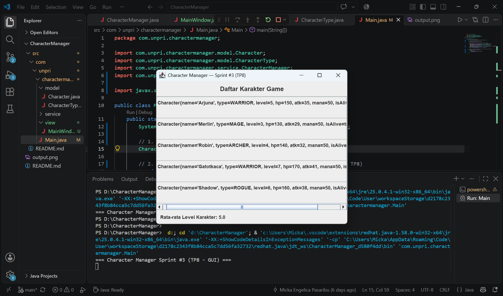

## TP10: Character Manager Sprint #4 (Theming & MVC Analysis)

- **Screenshot Sebelum (v0.3):**  
  

- **Screenshot Sesudah (v0.4 / AppTheme):**  

- **Penjelasan Singkat:**
  Seluruh properti visual seperti warna, font, dan border dipindahkan secara terpusat ke kelas `AppTheme` pada layer **View**. Hal ini memastikan bahwa layer **Model** (`Character.java`) tetap murni tanpa terikat pustaka GUI (`java.awt`).

- **Properti Tambahan (Mini-Challenge & Bonus):**
  1. *Highlight Level Tinggi:* Karakter dengan level $\ge 5$ otomatis tampil dengan teks tebal berwarna emas (`AppTheme.GOLD_HIGHLIGHT`).
  2. *Warna Role Dinamis:* Kartu karakter memiliki warna latar belakang berbeda berdasarkan *role* (Warrior, Mage, Archer) menggunakan `AppTheme.colorFor()`.

- **[Link Google Docs Analisis](https://docs.google.com/document/d/1RxpGbGyFrAPlwNqKqCyKHcAZr1LCiqrgrbmHHJVzlfQ/edit?usp=sharing)
