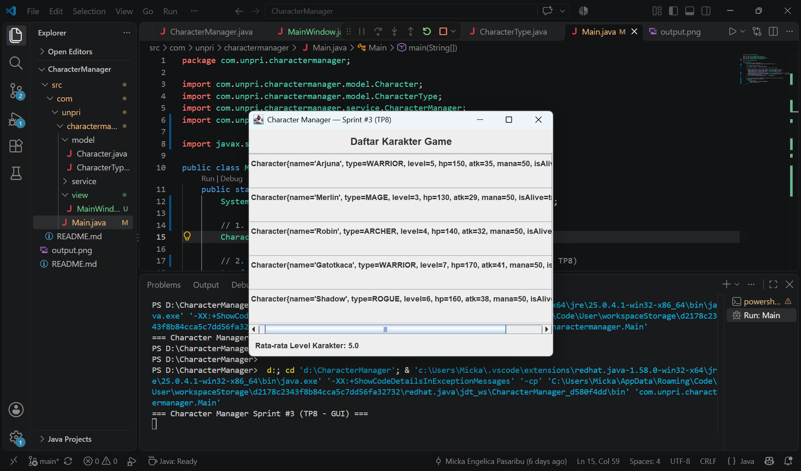
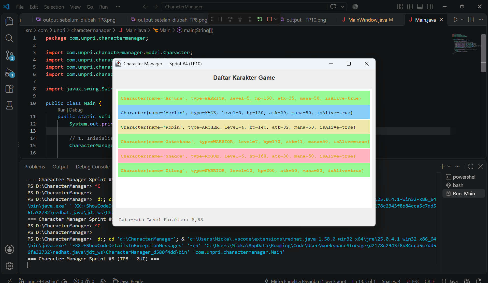
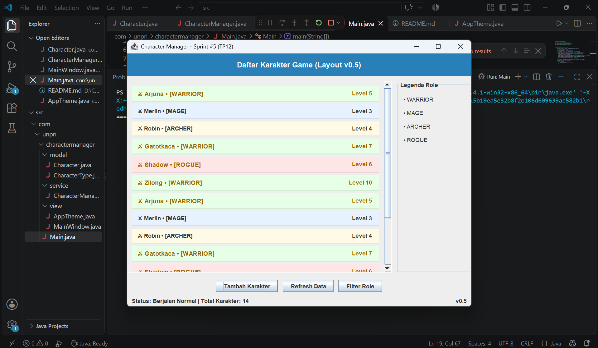
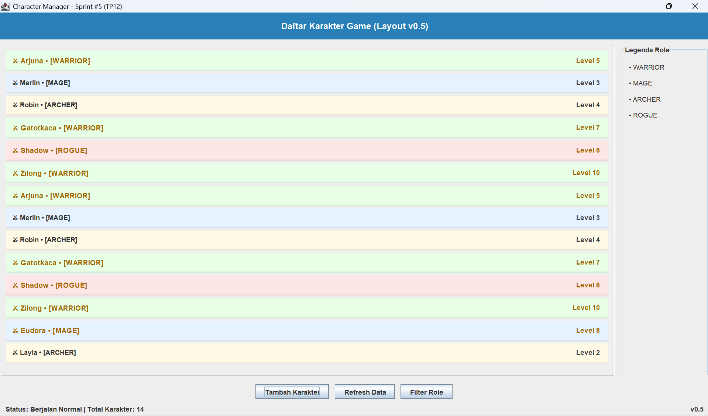
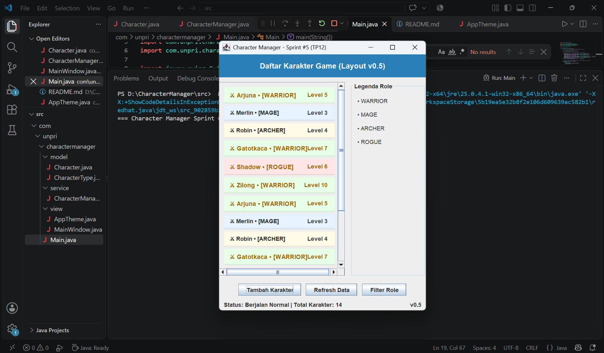

# Character Manager — TP3 (Java Visual SIH-6406)

## Deskripsi Singkat
Aplikasi berbasis console Java berorientasi objek (OOP) ini dirancang untuk mengelola data karakter game (seperti Warrior, Mage, Archer, dan Rogue). Proyek ini mengimplementasikan konsep enkapsulasi, validasi state objek menggunakan exception, serta manajemen atribut lanjutan termasuk poin nyawa (`hitPoints`), kekuatan serangan (`attackPower`), dan energi sihir (`mana`).


## Struktur Folder Project
```text
CharacterManager/
└── src/
    ├── Main.java
    └── com/
        └── unpri/
            └── charactermanager/
                └── model/
                    ├── Character.java
                    └── CharacterType.java
```

## Informasi Mahasiswa & Link Laporan
- **Nama Lengkap:** [Micka Engelica Pasaribu]
- **NIM:** [253303621262]
- **Link Google Docs Analisis Desain:** (https://docs.google.com/document/d/1yrO1K-XPf3lqHpAszVR-DR-0uy27xzLEABE_1up2ERs/edit?usp=sharing)


# Character Manager — TP5 (CRUD & Fitur Analitik Rancangan Sendiri)

## Deskripsi Proyek & Fitur CRUD
- **Penjelasan Singkat:** Pada TP5 ini, aplikasi dikembangkan dengan menambahkan fungsionalitas lengkap operasi **CRUD (Create, Read, Update, Delete)** pada pengelolaan data karakter, serta penerapan eksperimen *reference* (acuan objek) dan validasi data.
**[Screenshot](output_tp5.png)

## ⚙️ Bagian C — Fitur Analitik Rancangan Sendiri (`findStrongest`)
- **Nama Method Baru:** `findStrongest()`
- **Rasional & Penjelasan:** 
  Method ini ditambahkan ke dalam kelas `CharacterManager` untuk mencari dan mengembalikan objek karakter yang memiliki tingkat level atau kekuatan (`attackPower`) tertinggi di dalam daftar. Method ini dirancang dengan tetap menjaga prinsip *Encapsulation* (mengembalikan salinan atau data yang aman tanpa mengekspos referensi `ArrayList` asli secara langsung) dan dilengkapi dokumentasi Javadoc singkat.

## 🔗 Informasi Mahasiswa & Link Laporan
- **Nama Lengkap:** Micka Engelica Pasaribu
- **NIM:** 253303621262
- [Link Google Docs Analisis Desain](https://docs.google.com/document/d/1-GuGZEAAyOIBXSY1C3hpibQm1w-c5SSQMT14Mx1MH-o/edit?usp=sharing)


# Character Manager — Sprint #3 (TP8)

## 📌 Deskripsi Proyek
Sprint #3 (TP8) ini merupakan transisi besar dari aplikasi berbasis console (TP1-TP5) menuju aplikasi berbasis **GUI (Graphical User Interface)** menggunakan **Java Swing** serta menerapkan standar arsitektur **MVC (Model-View-Controller)**.

## 🖼️ Screenshot Aplikasi (`MainWindow`)
- **Kondisi Awal (5 Karakter):**
  
- **Kondisi Setelah Perubahan (6 Karakter & Statistik Berubah):**
  

## 🔄 Alur Aliran Data (MVC)
Aliran data dalam aplikasi ini berjalan secara terstruktur: 
1. `Main.java` menginisialisasi **Model** (`Character`) dan **Service/Controller** (`CharacterManager`).
2. `CharacterManager` mengelola kumpulan data karakter di dalam *ArrayList* dengan enkapsulasi yang aman.
3. `MainWindow` (**View**) meminta data dari `CharacterManager` melalui *looping* dinamis dan menampilkan antarmuka grafis ke pengguna secara aman di dalam *Event Dispatch Thread* (`SwingUtilities.invokeLater`).

## 📋 Daftar Karakter
1. **Arjuna** — Type: `WARRIOR`, Level: 5 (Karakter pejuang utama)
2. **Merlin** — Type: `MAGE`, Level: 3 (Karakter penyihir pengendali mana)
3. **Robin** — Type: `ARCHER`, Level: 4 (Karakter pemanah jarak jauh)
4. **Gatotkaca** — Type: `WARRIOR`, Level: 7 (Karakter tank penahan serangan tinggi)
5. **Shadow** — Type: `ROGUE`, Level: 6 (Karakter assassin gesit)
6. **Zilong** — Type: `WARRIOR`, Level: 10 (Karakter pejuang tambahan level tinggi)

## 🔗 Tautan Analisis Desain (Google Docs)
Analisis mendalam mengenai GUI, *Event-Driven*, dan prinsip arsitektur MVC dapat diakses melalui tautan berikut:
[Google Docs - Analisis GUI & MVC TP8](https://docs.google.com/document/d/15R7Eg3ea84QBOFNA2BMvkpym7Gk6FiCPGKG7yd8zrJ8/edit?usp=sharing)


## TP10: Character Manager Sprint #4 (Theming & MVC Analysis)

- **Screenshot Sebelum (v0.3):**  
  

- **Screenshot Sesudah (v0.4 / AppTheme):**  
   

- **Penjelasan Singkat:**
  Seluruh properti visual seperti warna, font, dan border dipindahkan secara terpusat ke kelas `AppTheme` pada layer **View**. Hal ini memastikan bahwa layer **Model** (`Character.java`) tetap murni tanpa terikat pustaka GUI (`java.awt`).

- **Properti Tambahan (Mini-Challenge & Bonus):**
  1. *Highlight Level Tinggi:* Karakter dengan level $\ge 5$ otomatis tampil dengan teks tebal berwarna emas (`AppTheme.GOLD_HIGHLIGHT`).
  2. *Warna Role Dinamis:* Kartu karakter memiliki warna latar belakang berbeda berdasarkan *role* (Warrior, Mage, Archer) menggunakan `AppTheme.colorFor()`.

- **[Link Google Docs Analisis](https://docs.google.com/document/d/1RxpGbGyFrAPlwNqKqCyKHcAZr1LCiqrgrbmHHJVzlfQ/edit?usp=sharing)


# TP12 — Layout Management & Panel Bersarang (Sprint #5)

## 📐 Section TP12: Wireframe / Diagram Struktur Layout

    +-------------------------------------------------------------------+
    |                        NORTH: Header Panel                        |
    +---------------------------------------------------+---------------+
    |                                                   |               |
    |                                                   |  EAST:        |
    |                  CENTER:                          |  Legenda      |
    |              JScrollPane                          |  Role         |
    |         (Panel Daftar Karakter)                   |  (BoxLayout   |
    |                                                   |   Y_AXIS)     |
    |                                                   |               |
    +---------------------------------------------------+---------------+
    |                  SOUTH: Action Panel (FlowLayout)                 |
    |             [Tambah Karakter] [Refresh Data] [Filter Role]        |
    +---------------------------------------------------+---------------+
    |  SOUTH: Status Bar (BorderLayout)                                 |
    |  Status: Berjalan Normal | Total Karakter: 14                v0.5 |
    +---------------------------------------------------+---------------+

---

## 📸 Dokumentasi 3 Screenshot Kondisi Jendela

* **Ukuran Awal (*Initial State*):**  
  

* **Jendela Dilebarkan (*Expanded Window*):**  
  

* **Jendela Dikecilkan (*Minimized Window / Scrollbar Tampak*):**  
  

---

## 📊 Tabel Pengamatan Resize (Prediksi vs Hasil)

| Kondisi Jendela | Prediksi Perilaku Layout | Hasil Pengamatan Aktual |
| :--- | :--- | :--- |
| **Ukuran Awal** | Header di `NORTH`, daftar kartu karakter di `CENTER`, legenda di `EAST`, panel tombol aksi dan status bar di `SOUTH` tampil proporsional. | Sesuai prediksi, seluruh komponen tertata rapi pada wilayah *BorderLayout* masing-masing. |
| **Dilebarkan** | Area daftar karakter dan header meregang secara horizontal, sementara panel legenda di `EAST` mempertahankan lebar tetapnya. | Sesuai prediksi, layout responsif secara konsisten tanpa ada komponen yang rusak. |
| **Dikecilkan** | Area daftar menyempit dan `JScrollPane` otomatis mengaktifkan bilah gulir (*scrollbar*) vertikal dan horizontal. | Sesuai prediksi, *scrollbar* aktif dengan sempurna sehingga seluruh konten data tetap dapat diakses. |

---

## 🏗️ Penjelasan Struktur Panel Bersarang
Aplikasi ini menerapkan arsitektur panel bersarang (*nested panels*) berbasis **`BorderLayout`** sebagai kerangka utama kontainer `JFrame`. Pada wilayah `CENTER`, daftar kartu karakter dibungkus oleh `JPanel` berorientasi vertikal (`BoxLayout`) yang dimasukkan ke dalam **`JScrollPane`** untuk menyediakan fitur pengguliran otomatis. Wilayah `EAST` menampung panel legenda tipe karakter menggunakan `BoxLayout` (sumbu `Y_AXIS`), sedangkan wilayah `SOUTH` mengintegrasikan panel tombol kontrol ber-layout **`FlowLayout`** dan bar status ber-layout **`BorderLayout`**. Desain hirarki ini memastikan setiap bagian antarmuka mengelola tata letaknya secara terisolasi, rapi, dan fleksibel.

---

## ⚙️ Alasan Panel Tambahan & Layout yang Ditolak

* **Panel Tambahan & Layout Dipilih (`FlowLayout`):**  
  Saya menambahkan panel tombol aksi (*placeholder*) di wilayah `SOUTH` tepat di atas bar status menggunakan **`FlowLayout`**. Layout ini dipilih karena sangat ideal untuk menyusun tombol kontrol secara horizontal di tengah secara alami tanpa memaksakan ukuran tombol menjadi melar secara kaku.
* **Layout yang Ditolak (`GridLayout`):**  
  Saya menolak penggunaan `GridLayout` untuk panel tombol aksi ini karena `GridLayout` akan memaksa setiap tombol memiliki ukuran lebar dan tinggi yang seragam serta meregang penuh memenuhi area kontainer, sehingga tampilannya terlihat tidak proporsional dan kurang natural.

---

## 🔗 Link Google Docs (Analisis Bagian D)

Tautan dokumentasi analisis lengkap (Bagian D — minimal 500 kata):  
👉 **[Link Google Docs Analisis Layout & MVC TP12](https://docs.google.com/document/d/1PG-sFx65DJDcDHFUAvyF3hKqsU9fOQjgY-5h5yJhGjA/edit?usp=sharing)**