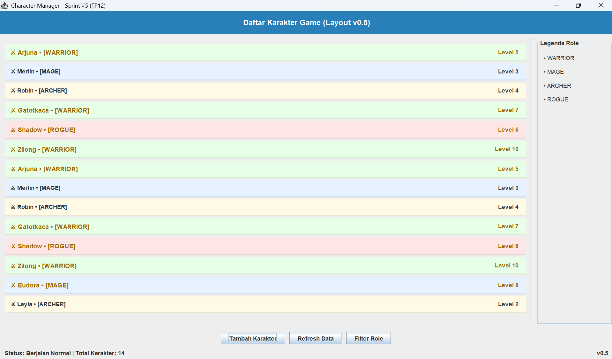

# TP12 — Layout Management & Panel Bersarang (Sprint #5)

## 📐 Section TP12: Wireframe / Diagram Struktur Layout

    +-------------------------------------------------------------------+
    |                        NORTH: Header Panel                        |
    +---------------------------------------------------+---------------+
    |                                                   |               |
    |                                                   |  EAST:        |
    |                  CENTER:                          |  Legenda      |
    |              JScrollPane                          |  Role         |
    |         (Panel Daftar Karakter)                   |  (BoxLayout   |
    |                                                   |   Y_AXIS)     |
    |                                                   |               |
    +---------------------------------------------------+---------------+
    |                  SOUTH: Action Panel (FlowLayout)                 |
    |             [Tambah Karakter] [Refresh Data] [Filter Role]        |
    +---------------------------------------------------+---------------+
    |  SOUTH: Status Bar (BorderLayout)                                 |
    |  Status: Berjalan Normal | Total Karakter: 14                v0.5 |
    +---------------------------------------------------+---------------+

---

## 📸 Dokumentasi 3 Screenshot Kondisi Jendela

- **Ukuran Awal (*Initial State*):**  
  

- **Jendela Dilebarkan (*Expanded Window*):**  
  

- **Jendela Dikecilkan (*Minimized Window / Scrollbar Tampak*):**  
  

---

## 📊 Tabel Pengamatan Resize (Prediksi vs Hasil)

| Kondisi Jendela | Prediksi Perilaku Layout | Hasil Pengamatan Aktual |
| :--- | :--- | :--- |
| **Ukuran Awal** | Header di `NORTH`, daftar kartu karakter di `CENTER`, legenda di `EAST`, panel tombol aksi dan status bar di `SOUTH` tampil proporsional. | Sesuai prediksi, seluruh komponen tertata rapi pada wilayah *BorderLayout* masing-masing. |
| **Dilebarkan** | Area daftar karakter dan header meregang secara horizontal, sementara panel legenda di `EAST` mempertahankan lebar tetapnya. | Sesuai prediksi, layout responsif secara konsisten tanpa ada komponen yang rusak. |
| **Dikecilkan** | Area daftar menyempit dan `JScrollPane` otomatis mengaktifkan bilah gulir (*scrollbar*) vertikal dan horizontal. | Sesuai prediksi, *scrollbar* aktif dengan sempurna sehingga seluruh konten data tetap dapat diakses. |

---

## 🏗️ Penjelasan Struktur Panel Bersarang
Aplikasi ini menerapkan arsitektur panel bersarang (*nested panels*) berbasis **`BorderLayout`** sebagai kerangka utama kontainer `JFrame`. Pada wilayah `CENTER`, daftar kartu karakter dibungkus oleh `JPanel` berorientasi vertikal (`BoxLayout`) yang dimasukkan ke dalam **`JScrollPane`** untuk menyediakan fitur pengguliran otomatis. Wilayah `EAST` menampung panel legenda tipe karakter menggunakan `BoxLayout` (sumbu `Y_AXIS`), sedangkan wilayah `SOUTH` mengintegrasikan panel tombol kontrol ber-layout **`FlowLayout`** dan bar status ber-layout **`BorderLayout`**. Desain hirarki ini memastikan setiap bagian antarmuka mengelola tata letaknya secara terisolasi, rapi, dan fleksibel.

---

## ⚙️ Alasan Panel Tambahan & Layout yang Ditolak

- **Panel Tambahan & Layout Dipilih (`FlowLayout`):**  
  Saya menambahkan panel tombol aksi (*placeholder*) di wilayah `SOUTH` tepat di atas bar status menggunakan **`FlowLayout`**. Layout ini dipilih karena sangat ideal untuk menyusun tombol kontrol secara horizontal di tengah secara alami tanpa memaksakan ukuran tombol menjadi melar secara kaku.
- **Layout yang Ditolak (`GridLayout`):**  
  Saya menolak penggunaan `GridLayout` untuk panel tombol aksi ini karena `GridLayout` akan memaksa setiap tombol memiliki ukuran lebar dan tinggi yang seragam serta meregang penuh memenuhi area kontainer, sehingga tampilannya terlihat tidak proporsional dan kurang natural.

---

## 🔗 Link Google Docs (Analisis Bagian D)

Tautan dokumentasi analisis lengkap (Bagian D — minimal 500 kata):  
👉 **[Link Google Docs Analisis Layout & MVC TP12](https://docs.google.com/document/d/1PG-sFx65DJDcDHFUAvyF3hKqsU9fOQjgY-5h5yJhGjA/edit?usp=sharing)**
