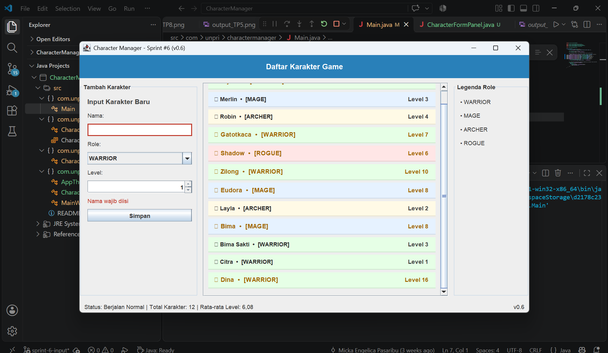

## TP14 Manajer Karakter Sprint #6

### Screenshot Pengujian Form
1. **Error Nama Kosong**: 
2. **Error Nama Duplikat**: 
3. **Sukses dengan Kartu Baru**: 

### Tabel Uji Validasi (Bagian B)
| No | Input | Hasil Diharapkan | Hasil Nyata | Lapisan yang Menangkap |
| :--- | :--- | :--- | :--- | :--- |
| 1 | Nama: `""`, Role: `WARRIOR`, Level: `1` | Ditolak: `"Nama wajib diisi"` | *(sesuai hasil uji)* | View (`validateName`) |
| 2 | Nama: `"   "`, Role: `WARRIOR`, Level: `1` | Ditolak: `"Nama wajib diisi"` | *(sesuai hasil uji)* | View (`validateName`) |
| 3 | Nama: `"Li"`, Role: `WARRIOR`, Level: `1` | Ditolak: `"Nama harus 3-20 karakter"` | *(sesuai hasil uji)* | View (`validateName`) |
| 4 | Nama: `"Gandalf  Putih"`, Role: `MAGE`, Level: `10` | Ditolak: `"Nama tidak boleh mengandung spasi ganda"` | *(sesuai hasil uji)* | View (`validateName`) |
| 5 | Nama: `"Hero123"`, Role: `WARRIOR`, Level: `1` | Ditolak: `"Nama hanya huruf dan spasi"` | *(sesuai hasil uji)* | View (`validateName`) |
| 6 | Nama duplikat (misal `"Arjuna"`), Role: `WARRIOR`, Level: `1` | Ditolak: `"Nama sudah dipakai"` | *(sesuai hasil uji)* | View (`validateName` / `isNameTaken`) |
| 7 | Nama: `"Merlin"`, Role: `MAGE`, Level: `65` | Ditolak: `"MAGE maksimal level 60"` | *(sesuai hasil uji)* | Model (`Character`) |
| 8 | Tambah karakter ke-21 saat sudah ada 20 karakter | Ditolak: `"Kapasitas karakter penuh (maksimal 20)"` | *(sesuai hasil uji)* | Model (`CharacterManager`) |

**Catatan Perbedaan & Perbaikan:**
- Jika ada baris dengan hasil nyata berbeda dari harapan, tulis di sini kasusnya, penyebabnya, dan perbaikan yang dilakukan (misalnya `[]` jika seluruh 8 kasus sudah sesuai harapan).

### Kompromi Sementara
Pada tahap ini, handler tombol simpan dan `Enter` pada `nameField` masih menggunakan `ActionListener` minimal yang memanggil `onSave()` secara langsung. Pemanggilan `manager.addCharacter(...)` juga masih dilakukan langsung dari `CharacterFormPanel` melalui objek `CharacterManager` yang diinjeksikan agar alur validasi dan pembaruan daftar cepat terhubung. Kompromi ini dipilih supaya fokus utama tetap pada kejelasan pemisahan aturan View vs. Model sebelum diperhalus pada iterasi berikutnya.

### Esai Bagian D (Google Docs)
[Link Google Docs Bagian D](https://docs.google.com/document/d/12qTgE9cTWLQBbtKdTEHmTZvPOyBmdu66WxyBiQsy-0Y/edit?usp=sharing)
