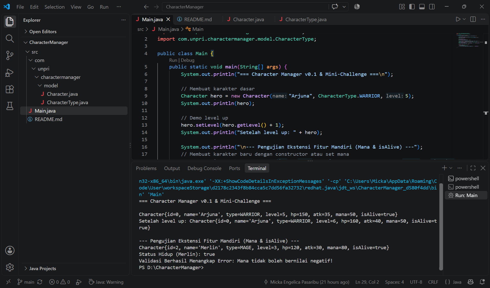

# Character Manager — TP5 (Java Visual SIH-6406)

## Deskripsi Singkat
Aplikasi berbasis console Java berorientasi objek (OOP) ini dirancang untuk mengelola data karakter game (seperti Warrior, Mage, Archer, dan Rogue). Proyek ini mengimplementasikan konsep enkapsulasi, validasi state objek menggunakan exception, serta manajemen atribut lanjutan termasuk poin nyawa (`hitPoints`), kekuatan serangan (`attackPower`), dan energi sihir (`mana`).

## Struktur Folder Project
```text
CharacterManager/
│
├── .gitignore
├── output.png
└── src/
    ├── Main.java
    └── com/
        └── unpri/
            └── charactermanager/
                ├── model/
                │   ├── Character.java
                │   └── CharacterType.java
                └── service/
                    └── CharacterManager.java

## Informasi Mahasiswa & Link Laporan
* **Nama Lengkap:** [Micka Engelica Pasaribu]
* **NIM:** [253303621262]
* **Link Google Docs Analisis Desain:** [https://docs.google.com/document/d/1yrO1K-XPf3lqHpAszVR-DR-0uy27xzLEABE_1up2ERs/edit?usp=sharing]

## Screenshot Output Program
