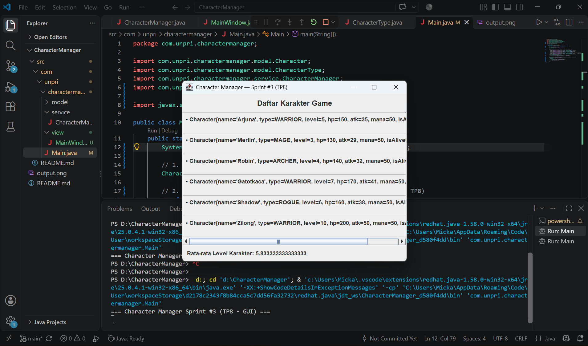

# Character Manager — Sprint #3 (TP8)

## Deskripsi Proyek
Sprint #3 (TP8) ini merupakan transisi dari aplikasi berbasis konsol menuju aplikasi berbasis GUI (Graphical User Interface) menggunakan Java Swing dengan menerapkan prinsip arsitektur MVC (Model-View-Controller).

## Screenshot Aplikasi (`MainWindow`)
- **Kondisi Awal (Sebelum Data Diubah):**
  

- **Kondisi Setelah Perubahan (Data Ditambah & Rata-rata Level Berubah):**
  

## Alur Aliran Data (MVC)
Pada aplikasi ini, `Main.java` menginisialisasi data karakter (`Character` sebagai Model) dan memasukkannya ke dalam `CharacterManager` (pengelola data/state). Selanjutnya, `MainWindow` (sebagai View) mengambil data karakter dari `CharacterManager` dan merender daftar secara dinamis melalui perulangan serta menghitung statistik rata-rata level. Seluruh pembuatan dan pembaruan komponen GUI dijalankan melalui `SwingUtilities.invokeLater()` agar berjalan aman di *Event Dispatch Thread* (EDT).

## Daftar Karakter Baru & Alasan Pemilihan Tipe/Level
- **Srikandi** — Type: `WARRIOR`, Level: `6` (Dipilih tipe `WARRIOR` dengan level menengah-tinggi untuk merepresentasikan karakter petarung tangguh yang memengaruhi kenaikan rata-rata level).
- **Zephyr** — Type: `MAGE`, Level: `2` (Dipilih tipe `MAGE` dengan level awal untuk menambah variasi role sekaligus menguji perubahan rata-rata level secara dinamis).

## Tautan Analisis Desain (Google Docs)
Analisis GUI, *Event-Driven*, dan prinsip MVC dapat diakses pada tautan berikut:
[Google Docs - Analisis GUI & MVC TP8](https://docs.google.com/document/d/15R7Eg3ea84QBOFNA2BMvkpym7Gk6FiCPGKG7yd8zrJ8/edit?usp=sharing)